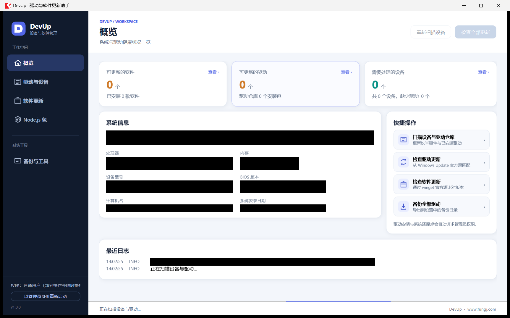

# DevUp · 驱动与软件更新助手

> 一个 Windows 桌面小工具：**看清设备健康状况、装对官方驱动、把已装软件升级到最新版**。
> 界面用 WPF 自绘，更新逻辑复用成熟的开源内核，以**单个 DevUp.exe** 分发，使用官方 **.NET 8 桌面运行时（x64）**，无需安装 DevUp。

- 作者：风之翼灵'Blog · <https://www.fungj.com>
- 版本：1.1.1（Windows 10 19041+ / Windows 11，x64）
- 许可证：MIT（第三方组件各自遵循其许可证，见 [docs/ATTRIBUTION.md](docs/ATTRIBUTION.md)）



---

## 1. 它解决什么问题

| 痛点 | DevUp 的做法 |
| --- | --- |
| 设备管理器里全是黄叹号，不知道该装什么驱动 | 枚举全部设备并标出异常；一键扫描 **Windows Update 官方驱动**，按本机硬件精确匹配 |
| 三方"驱动大师"捆绑、装错版本 | 只用 WUA（Windows Update Agent）与 Microsoft Update Catalog，不下载来路不明的驱动包 |
| 软件更新要一个个点、版本还对不上 | 复用 `winget` 的官方清单，按 **名称 + 已装版本** 双重匹配，避免同名软件误升级 |
| 升级失败没法回滚 | 安装驱动前可自动备份驱动仓库、创建系统还原点 |
| 权限太吓人 | 主界面以普通权限运行，**只在真正需要时**弹一次 UAC |

## 2. 功能一览

### 概览
可点击的统计卡片（可更新软件 / 可更新驱动 / 需要处理的设备），点「查看 ›」直接跳转并自动套用筛选；系统信息磁贴与最近日志。

### 驱动与设备
- 设备列表：状态彩色标签、按状态筛选、点击行查看驱动版本 / 提供者 / INF / 硬件 ID / 服务名。
- 可用驱动更新：来自 Windows Update 官方源，勾选后「安装选中的 N 项」或「安装全部」。
- 安装前可选：备份相关驱动包（`pnputil /export-driver`）、创建系统还原点（`Checkpoint-Computer`）。
- 一键注册 **Microsoft Update 扩展源**（可搜到显卡 / 网卡等第三方官方驱动）。
- Windows Update 里没有的驱动，可用「查目录」按硬件 ID 检索 Microsoft Update Catalog。

### 软件更新
- `winget list --source winget` 精确比对，显示「已装版本 → 可用版本」；无更新时也保留包 ID，可查看清单信息。没有升级不代表已是厂商最新版，软件源可能落后于官网。
- 选中一行后展示 **官方更新说明、发布日期、安装包类型、官方下载地址**，以及 `winget show` 清单登记的 **SHA256**。
- 「下载并校验安装包」保存安装包到下载目录，并计算本地 **SHA256 + MD5** 与官方清单值比对：
  - 一致 → 显示「校验一致」，确认安装包与 winget 官方清单完全相同；
  - 不一致 → 红色警示，建议不要运行；
  - 清单未登记 SHA256 → 明确标注「仅本地计算」，**不伪造校验值**。
- 设备、驱动、软件和 npm 扫描显示真实步骤或已读取数量，并提供取消和超时后的失败提示；失败后可重新检查。
- 单条 / 批量升级；winget 流程显示可确认的下载、校验和安装阶段，并在长期无进展时提示重试，不显示推测的下载百分比。升级通过隐藏伪终端读取 winget 的实时下载计数，兼容 Windows 传递优化下载；百分比来自已下载字节与总量，速度来自计数增量。下载、校验和安装分别显示，校验后保留已下载总量；不再依赖缓存文件出现的时机。下载器尚未报告总量时不显示推测的百分比。速度、下载量和进度分栏显示，说明放在悬浮提示中。单独下载安装包时显示实际下载量、速度和剩余时间，网络中断会自动重试。升级结束后清理 `%TEMP%\WinGet` 临时安装包。
- 升级失败不会甩出 winget 原始错误，而是给出**原因 + 下一步**（重试安装 / 打开官方下载页 / 需要管理员权限等）。

### Node.js 包
管理 npm 全局安装的 AI 命令行工具（Codex、Claude Code 等）与 pnpm 等：检查更新、升级、卸载。
检测不到 Node.js 或 npm 损坏时，只给友好提示与官方下载入口，**不会自动安装**。

### 备份与工具
驱动备份目录、安装包下载目录可自由选择并持久化；驱动包备份 / 还原、系统还原点、报告导出（JSON / HTML）、运行日志。

### 启动方式
首次启动会询问「以管理员权限运行 / 以普通权限运行」，可勾选「记住我的选择」，之后在「备份与工具 → 启动方式」随时改回每次询问。
普通权限下，只有驱动安装、驱动备份还原、创建还原点等系统级操作才会单独弹 UAC；**取消 UAC 会回落到普通权限继续运行**，不会中断使用。

## 3. 架构

```
DevUp.exe（WPF 外壳，单文件，依赖官方 .NET 8 桌面运行时）
├─ Views/       概览 / 驱动与设备 / 软件更新 / Node.js 包 / 备份与工具
│               + 自绘 MessageDialog、ProgressDialog、StartupDialog
├─ Services/    DeviceService、DriverStoreService、DriverUpdateService、
│               SoftwareService、NpmService、BackupService、ReportService
├─ Core/        Ctx（全局状态）、Scanner（扫描编排）、PsBridge（PowerShell 桥）、
│               Native（提权 / 签名校验）、Ui、CommandLine
└─ Scripts/devup.ps1   PowerShell 后端（WUA / winget / pnputil / CIM）
```

**调用链**：WPF → `PsBridge` → `powershell.exe -NoProfile -ExecutionPolicy Bypass -File devup.ps1 -Action <动作> -OutFile <临时文件>`
所有动作统一返回 JSON 契约：

```json
{ "ok": true, "action": "devices", "data": { }, "error": null }
```

**提权模型**：主进程 `asInvoker`。需要管理员的动作以 `--elevated-action <动作> --elevated-args <json> --elevated-out <文件>` 重新启动自身副本，由系统弹 UAC，结果经文件回传。

**便携数据目录**（exe 旁只生成一个 `DevUpData/` 总目录；以下路径均相对于该总目录，不使用启动时的工作目录）：

| 文件 | 位置 | 说明 |
| --- | --- | --- |
| 普通权限运行组件 | `runtime/user/` | 从内嵌资源释放 |
| 管理员运行组件 | `runtime/s-<随机>/` | 保留 ACL 保护，进程退出时清理 |
| 设置 | `data/settings.json` | 程序目录内的路径保存为相对路径，移动后仍有效 |
| 日志 | `logs/devup.log` | 随程序保存 |
| 通信临时文件、PowerShell 模块分析缓存 | `temp/` | 动作完成后删除通信文件 |
| 驱动备份、离线安装包 | 默认 `backups/`、`downloads/` | 可通过界面选择其他目录 |

应用自有目录或用户选择的目录不可写时会明确报错，不静默回退到用户目录或系统目录。
上一版 exe 旁 `data/settings.json` 中的配置会自动迁入 `DevUpData/data/settings.json`，保留用户选择的外部目录；旧默认下载和备份路径改到总目录下，旧文件不自动移动或删除。更早版本留在 AppData / ProgramData 中的数据不会自动迁移或删除；需要保留时，可自行复制 settings.json 到 DevUpData/data/。
便携范围限于 DevUp 自身。npm、winget、Windows Update 和软件安装器保留官方安装路径、缓存及系统服务行为；仅在用户执行相应操作时进行安装、更新、备份或导出。不修改 npm prefix、缓存配置、系统环境变量或第三方软件安装目录。

> 提权子进程收到的参数来自外部，一律按不可信输入处理：更新 ID 必须是合法 GUID，驱动包名必须匹配 `oemN.inf`。

## 4. 复用的开源项目

| 组件 | 版本 | 许可证 | 用途 | 复用方式 |
| --- | --- | --- | --- | --- |
| [Nefarius.Utilities.DeviceManagement](https://github.com/nefarius/Nefarius.Utilities.DeviceManagement) | 6.1.0 | MIT | SetupAPI / CfgMgr32 / DriverStore 封装，读取 DriverStore 驱动包 | NuGet 包引用 |
| [PSWindowsUpdate](https://github.com/mgajda83/PSWindowsUpdate) | 2.2.1.5 | MIT | 通过 WUA 搜索、下载、安装驱动更新 | 模块内嵌（`lib/PSWindowsUpdate`） |
| [MSCatalog](https://github.com/ryan-jan/MSCatalog) | 0.27.0 | MIT | 检索 Microsoft Update Catalog 上的离线更新 | 模块内嵌（`lib/MSCatalog`） |
| [winget](https://github.com/microsoft/winget-cli) | 系统自带 | MIT | 软件清单、版本比对、升级、下载 | 调用外部 CLI |
| pnputil / Checkpoint-Computer / Get-PnpDevice | 系统自带 | — | 驱动导出还原、系统还原点、设备枚举 | 命令行 / CIM |

> 本项目**没有**复制任何 GPL / AGPL 项目的源码（例如 SDIO 一类工具），只借鉴其思路后自行实现。
> 各组件版权与完整许可证文本见 [`docs/ATTRIBUTION.md`](docs/ATTRIBUTION.md)。

## 5. 构建

要求：Windows 10 19041+ / Windows 11、.NET 8 SDK、PowerShell 5.1 或 7。

```powershell
powershell -ExecutionPolicy Bypass -File scripts\build.ps1
```

产物：`build\single-file\DevUp.exe`，仅分发这一个文件。运行电脑需要官方 **.NET 8 Desktop Runtime（x64）**；普通 .NET Runtime 不包含 WPF，不能替代桌面运行时。程序不会自行安装运行时，也不携带需要自解压的原生运行时依赖。

> **编码提示**：`src\DevUp\Scripts\devup.ps1` 含中文，必须保存为 **UTF-8 with BOM**，
> 否则 PowerShell 5.1 会按 GBK 解析而报错。可用 `scripts\fix-encoding.ps1` 批量校正。

## 6. 使用

1. 将 `DevUp.exe` 放到可写目录，确认已安装官方 .NET 8 桌面运行时（x64），双击运行，按需选择管理员 / 普通权限（可记住）。
2. **概览**：看三张卡片，点「查看 ›」进入对应功能页。
3. **驱动与设备**：点「扫描驱动更新」查询官方驱动（需管理员时会弹 UAC）；左上下拉框可筛选「仅异常设备 / 缺失驱动 / 未连接的设备」；右下「可用驱动更新」勾选左侧方框 → 「安装选中的 N 项」。
4. **软件更新**：点「检查更新（winget）」→ 用「仅可更新」筛选 → 点一行查看官方更新说明与 SHA256 → 右侧「升级到此版本 / 下载安装包」，或用「全部升级」。
5. **备份与工具**：设置驱动备份目录、安装包下载目录；查看日志、导出报告。

## 7. 常见问题

**Q：扫描驱动更新没反应 / 提示权限不足？**
确认弹出的 UAC 已同意。未注册 Microsoft Update 时只能搜到微软自家驱动，可点「启用 Microsoft Update 扩展源」。

**Q：软件列表是空的？**
需要系统已安装 `winget`（App Installer）。在终端执行 `winget --version` 验证。

**Q：升级后磁盘里还留着安装包？**
升级流程（含失败与取消）都会清理 `%TEMP%\WinGet` 下的临时包；「下载安装包」按设计保留在你选择的目录，方便离线安装。

**Q：软件更新里的 SHA256 / MD5 从哪里来？能证明是官方包吗？**
SHA256 来自 `winget show` 读取的 winget 官方源清单（与 `winget` 安装前校验的值相同），界面会标明来源；MD5 只在本地下载后计算，用于留档核对。点「下载并校验安装包」后，DevUp 会把本地 SHA256 与清单值逐位比对：一致才显示绿色「校验一致」，不一致会红色警示。清单未提供哈希的软件会明确写明"仅本地计算"，不会编造。

**Q：为什么第一次点窗口时没反应？**
程序已对首次激活点击做兼容处理；若仍遇到，请再点一次并反馈 exe 旁的日志 `DevUpData\logs\devup.log`。

## 8. 目录结构

```
DevUp/
├─ src/DevUp/            主工程（WPF + 服务 + 内嵌脚本）
├─ lib/                  内嵌的开源 PowerShell 模块（PSWindowsUpdate、MSCatalog）
├─ scripts/              构建、编码修正、调试脚本
├─ docs/                 第三方署名与许可证
├─ build/single-file/    单文件发布产物 DevUp.exe（git 忽略）
└─ .github/workflows/    CI：构建校验
```

## 9. 许可证

本项目自身代码由 风之翼灵'Blog 维护，以 MIT 许可证发布；随包内第三方组件遵循各自的 MIT 许可证（见 `docs/ATTRIBUTION.md` 与 `LICENSE`）。

便携路径回归检查：`dotnet run --project tests/DevUp.PortableTests -c Release`（含真实 PowerShell 调用；不安装软件或驱动）。
